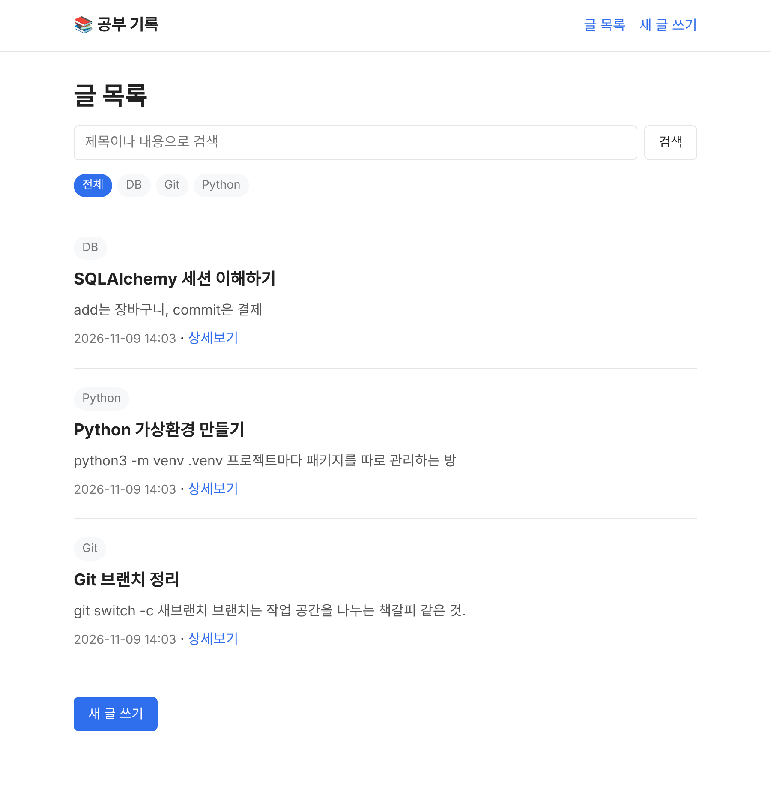
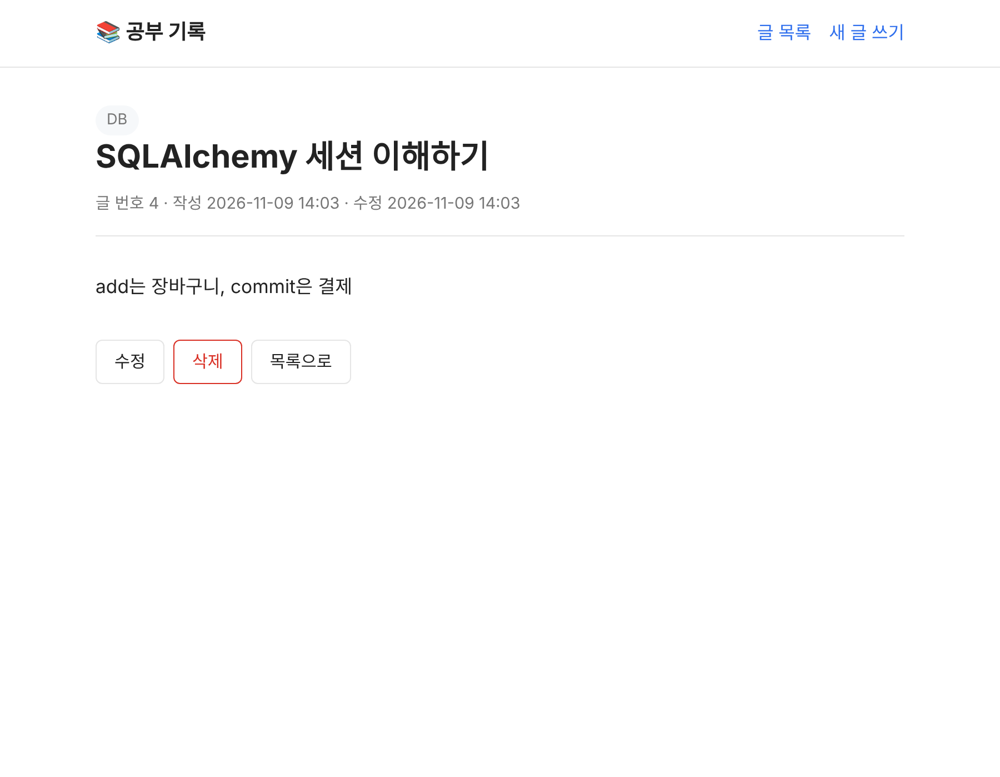
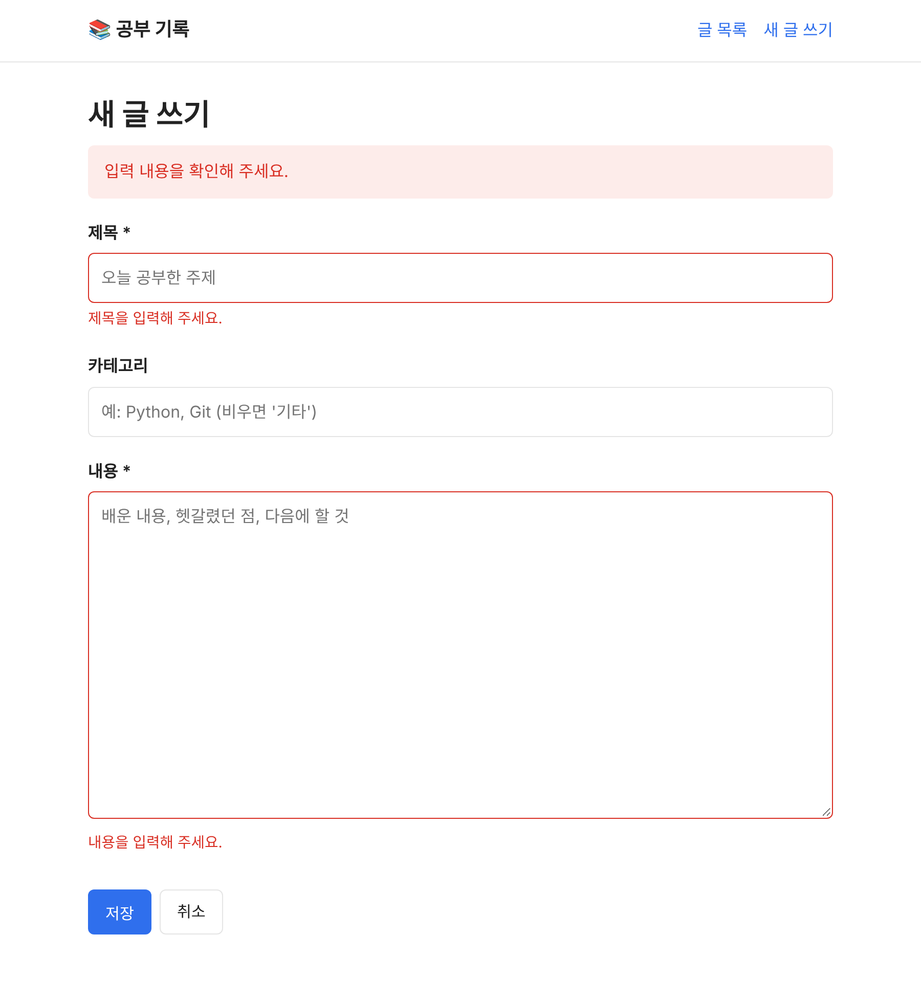

# 📚 공부 기록 블로그

매일 공부한 내용을 글로 남기는 블로그형 웹 서비스입니다.
FastAPI와 SQLAlchemy로 만들었고, 글을 **등록 · 목록 · 상세 · 수정 · 삭제(CRUD)** 할 수 있습니다.

## 주요 기능

- 글 등록, 목록, 상세, 수정, 삭제
- 등록/수정/삭제 후 **PRG 패턴**(POST → 303 Redirect → GET)으로 새로고침 시 중복 요청 방지
- 제목/내용 **검색** (`/posts?q=검색어`)
- **카테고리별 보기** (`/posts?category=Python`)
- 필수값 **검증**: 제목·내용이 비어 있으면 저장하지 않고 안내 문구 표시
- 삭제 전 **확인 창**
- 존재하지 않는 글은 "해당 글을 찾을 수 없습니다" 안내 화면(404)

## 기술 스택

| 구분 | 사용 기술 |
|---|---|
| 언어 | Python 3.10 이상 |
| 웹 프레임워크 | FastAPI, Uvicorn |
| DB / ORM | SQLite, SQLAlchemy 2.x |
| 화면 | Jinja2 템플릿 (SSR) |
| 폼 처리 | python-multipart |

## 실행 방법

### 1. 저장소 받기

```bash
git clone https://github.com/<your-github-id>/B6-2.git
cd B6-2
```

### 2. 가상환경 만들고 켜기

```bash
python3 -m venv .venv
source .venv/bin/activate        # Windows: .venv\Scripts\activate
```

### 3. 패키지 설치

```bash
pip install -r requirements.txt
```

### 4. 서버 실행

```bash
uvicorn app.main:app --reload
```

아래 로그가 보이면 정상 실행된 것입니다.

```
INFO:     Uvicorn running on http://127.0.0.1:8000 (Press CTRL+C to quit)
INFO:     Application startup complete.
```

브라우저에서 <http://localhost:8000> 에 접속합니다.
서버가 처음 켜질 때 프로젝트 폴더에 `database.db` 파일이 자동으로 만들어집니다.

## 화면과 URL

| 메서드 | URL | 화면 / 동작 |
|---|---|---|
| GET | `/` | 홈 |
| GET | `/posts` | 글 목록 (검색 `?q=`, 카테고리 `?category=`) |
| GET | `/posts/new` | 새 글 작성 폼 |
| POST | `/posts` | 글 등록 → `/posts/{id}` 로 303 리다이렉트 |
| GET | `/posts/{id}` | 글 상세 |
| GET | `/posts/{id}/edit` | 글 수정 폼 |
| POST | `/posts/{id}/edit` | 글 수정 → `/posts/{id}` 로 303 리다이렉트 |
| POST | `/posts/{id}/delete` | 글 삭제 → `/posts` 로 303 리다이렉트 |

## 프로젝트 구조

```
B6-2/
├── app/
│   ├── main.py                 # 앱 시작점: 테이블 생성, 라우터 등록
│   ├── database.py             # DB 연결, 세션 공급(get_db → Depends)
│   ├── templating.py           # Jinja2 템플릿 설정
│   ├── models/post.py          # SQLAlchemy ORM 모델 (posts 테이블)
│   ├── schemas/post.py         # Pydantic 스키마 (화면에 넘기는 DTO)
│   ├── repositories/post_repository.py  # 데이터 접근 (DB 읽기/쓰기)
│   ├── services/post_service.py         # 비즈니스 로직 (검증, 없는 글 처리)
│   ├── routers/
│   │   ├── home_router.py      # GET /
│   │   └── post_router.py      # /posts 요청/응답, 리다이렉트
│   └── templates/              # base, home, list, detail, form, not_found
├── docs/screenshots/           # 주요 화면 스크린샷
├── requirements.txt
└── README.md
```

## 요청 흐름 (글 등록 예시)

```
브라우저  POST /posts  (폼: title, content, category)
  → routers   post_router.create        Form()으로 입력값 받기
  → services  post_service.create_post  공백 제거, 필수값 검증, 카테고리 기본값
  → repositories post_repository.save   session.add → commit → refresh
  → SQLite (database.db)
  ← 303 Redirect: /posts/{id}
브라우저  GET /posts/{id}
  → router → service → repository → 템플릿(detail.html) 렌더링
```

| 레이어 | 하는 일 | 모르는 것 |
|---|---|---|
| Router | URL, 폼 입력, 화면 선택, 리다이렉트 | DB, 검증 규칙의 세부 내용 |
| Service | 앱의 규칙 (검증, 없는 글 처리) | SQL, HTML |
| Repository | SQLAlchemy로 DB 읽기/쓰기 | 검증 규칙, 화면 |

## 데이터 모델 (`posts` 테이블)

| 필드 | 타입 | 설명 |
|---|---|---|
| id | INTEGER | 글 번호 (자동 증가) |
| title | VARCHAR(100) | 제목 (필수) |
| content | TEXT | 내용 (필수) |
| category | VARCHAR(30) | 카테고리 (비우면 "기타") |
| created_at | DATETIME | 작성일시 (자동) |
| updated_at | DATETIME | 수정일시 (수정 시 자동 갱신) |

## 저장된 데이터 직접 확인하기

[DB Browser for SQLite](https://sqlitebrowser.org/)로 `database.db`를 열거나, **프로젝트 루트(`B6-2/`)에서** 아래 명령으로 확인할 수 있습니다.
서버를 한 번 이상 실행해서 `database.db`가 만들어진 뒤에 실행합니다.

```bash
python3 -c "import sqlite3; [print(r) for r in sqlite3.connect('file:database.db?mode=ro', uri=True).execute('SELECT id, title, category, created_at FROM posts')]"
```

> `mode=ro`(읽기 전용)를 붙인 이유: 다른 폴더에서 실행하면 `sqlite3.connect()`가 그 폴더에 **빈 DB 파일을 새로 만들어** `no such table: posts` 에러가 납니다. 읽기 전용으로 열면 새 파일을 만들지 않고 `unable to open database file` 에러로 바로 알려 줍니다.

## 스크린샷

| 글 목록 | 글 상세 | 입력 검증 |
|---|---|---|
|  |  |  |
